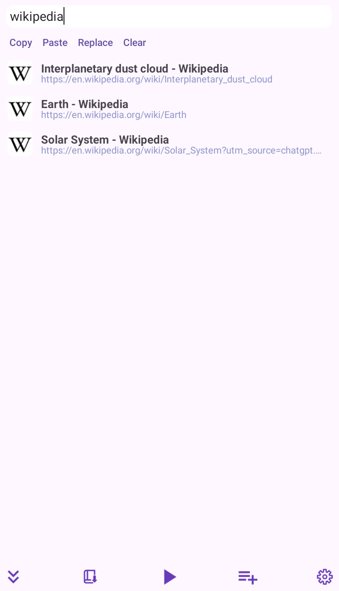
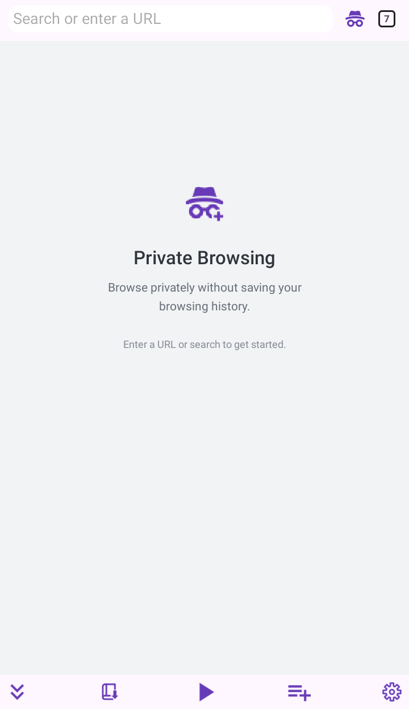

# Web Reader: Read Text Aloud

An Android application that turns web pages into spoken content using text-to-speech technology. It provides a customizable reading experience with background playback, multilingual support, and tools for managing web content.

**Version:** 1.6.1

## Features

- **Text-to-Speech:** Read web page content aloud using Android TextToSpeech.
- **Background Reading:** Continue listening while using other applications or when the screen is locked.
- **WebView Integration:** Browse web pages and extract content for text-to-speech playback.
- **Automatic Page Navigation:** Automatically continue reading through web pages.
- **Ad Blocking:** Block unwanted advertisements and tracking-related content using a local host list.
- **Text Simplification:** Reduce repetitive characters and words to improve the listening experience.
- **Bookmark Management:** Save and manage favorite web pages.
- **Offline Reading:** Download and manage web pages for later access.
- **Multilingual Support:** English, Simplified Chinese, and Traditional Chinese interfaces.

## Technologies

- Java
- Kotlin
- Android SDK
- Android WebView
- Android TextToSpeech (TTS)
- Android Foreground Services
- Clerk
- SQLite
- JavaScript
- Gradle

## Technical Highlights

- Integrated Android WebView with JavaScript to extract and process web page content.
- Implemented text-to-speech playback with background execution through Android foreground services.
- Managed reading state and navigation between web pages.
- Implemented local advertisement blocking using host-based filtering.
- Used SQLite for persistent data storage.
- Integrated JavaScript and Android Java through WebView JavaScript interfaces.

## Requirements

- Android 8.0 (API 26) or later.
- Android device or emulator with a supported text-to-speech engine.

## Screenshots

### Browsing Experience

<table>
  <tr>
    <td align="center">
      
       
      <b>Main Screen</b>
    </td>
    <td align="center">
      
       
      <b>Tab Management</b>
    </td>
    <td align="center">
      
       
      <b>Smart Address Bar</b>
    </td>
  </tr>
</table>

### Bookmarks and Privacy

<table>
  <tr>
    <td align="center">
      
       
      <b>Bookmarks</b>
    </td>
    <td align="center">
      
       
      <b>Private Browsing</b>
    </td>
  </tr>
</table>

### Reading Experience

<table>
  <tr>
    <td align="center">
      
       
      <b>Light Theme</b>
    </td>
    <td align="center">
      
       
      <b>Dark Theme</b>
    </td>
  </tr>
</table>

## Download

https://play.google.com/store/apps/details?id=com.blueberryjoy.reader

## License

This project is licensed under the MIT License. See the [LICENSE](LICENSE) file for details.
